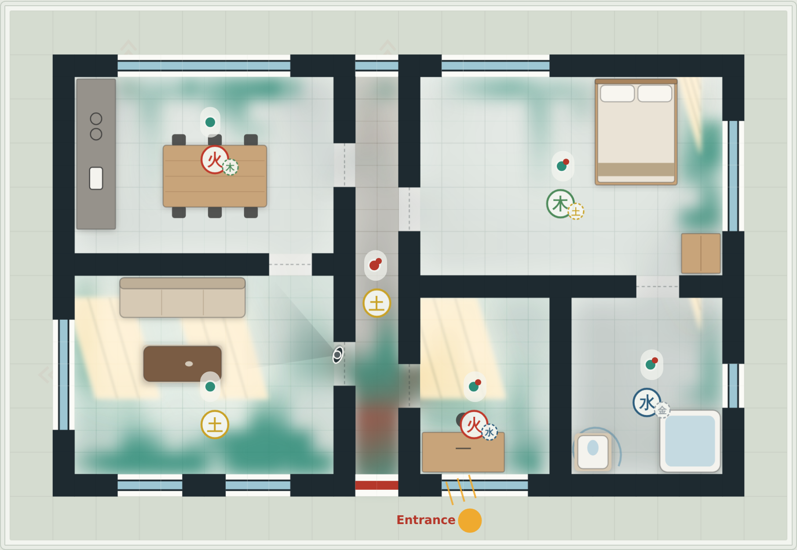

# Flow of Chi

Feng shui for your floor plan: an interactive visualiser that shows how chi moves through a home, and how that makes it feel.

**[See it live at flowofchi.nicolelin.com →](https://flowofchi.nicolelin.com)**

## What it does

Chi enters through the front door, drifts through the rooms like ink in water, speeds up along straight hallways, goes stale in dark corners and slips out through windows and drains. Drag the furniture, add walls or doors, or place a cure (a plant, lamp, stone vase, wind chime or water bowl), and the chi re-routes as you watch. Each room gets a reading of how it feels, its balance of the five elements against the bagua map, and suggestions you can toggle on to see the difference. There's also a first-person walkthrough of the home.

It models classic feng shui ideas, such as the command position, the "mouth of chi", sha chi from long straight lines, and the five-element cycles, alongside real sunlight calculated from the time, month, latitude and orientation.

## Built with

Vanilla JavaScript and the Canvas 2D API in a single HTML file. No framework, no build step, no dependencies. Google Fonts is the only external request.

## Run it locally

Download the repo and open `index.html` in a browser. That's it.

## Accessibility

Controls are real buttons and switches with ARIA labels and states. The compass can be turned with the arrow keys, and changes are announced through a live region. The page respects `prefers-reduced-motion` and adapts to light and dark mode.

---

Made by [Nicole Lin](https://nicolelin.com).
